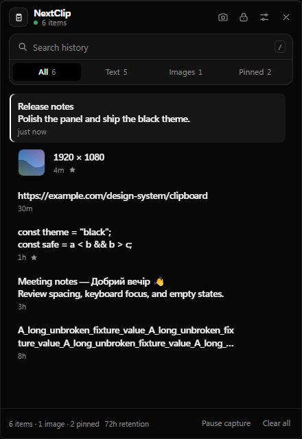

# NextClip

A lightweight, encrypted clipboard history panel for Windows (Electron, ~90 MB installed, no server, no network access).

Copy anything — text or images — and it lands in an encrypted history you can search, pin and paste back from with one hotkey. It also doubles as a screenshot tool.



## What it does

- **Captures text and images** from the clipboard in the background.
- **Encrypts everything at rest.** One file, `vault.json`, sealed with AES-256-GCM.
- **Pin anything** — pinned items are exempt from every automatic deletion.
- **Auto-delete after 72 hours** (configurable) so the history does not grow forever.
- **Region screenshots** with one hotkey: freeze the screen, drag out an area, and it lands on the clipboard and in the history — save it to disk if you want to keep it.
- **Search, filter and restore.** `All / Text / Images / Pinned` chips plus full-text search; click any row to put it back on the clipboard.
- **Auto-locks** after an idle timeout, dropping the key from memory.
- **Black theme throughout.** The panel, bubble, settings, capture overlay and native controls use a consistent dark palette.
- **Launcher bubble.** Keep the bubble pinned on screen, or hide it with a right-click and restore it from Settings or the tray.
- **Remembered unlock.** Optionally keep the vault unlocked across restarts on the same Windows boot, with an expiry you control.

## Quick start

```bash
npm install
npm start
```

On first run the panel asks you to create a vault. Pick a passphrase — it is never stored, and there is no recovery if you lose it.

Press **Ctrl+Shift+V** anywhere to show/hide the panel. It also lives in the system tray (padlock icon).

The black launcher bubble stays on screen while the panel is closed. Right-click it to hide it. Restore it with **Pin bubble on screen** in the tray menu, or enable the same switch in **Settings → Panel** and press **Done**. Your choice is remembered after restarting. The panel hotkey and tray continue to work while the bubble is hidden.

## Screenshots

Press **Ctrl+Shift+S** and the screen freezes under a selection overlay.

| Action | How |
| --- | --- |
| Select a region | Drag |
| Force a square | Hold `Shift` while dragging |
| Confirm | `Enter` or release the mouse |
| Cancel | `Esc` (also cancels if you click away) |

The captured region goes straight to the clipboard, so the monitor files it into the encrypted history like any other copy — it shows up as a normal image entry you can restore or save later. Turn on **Also save screenshots to disk** in settings to additionally write each shot to `Pictures/NextClip` with a timestamped name, or press `S` on any image in the history to save it anywhere you like.

Notes on the capture:

- Screens are captured **before** the overlay opens, so the overlay never appears in its own screenshot, and the crop is taken from that frozen snapshot rather than from screen.
- One overlay is placed per display, so multi-monitor setups can capture on any screen.
- If the window ends up a different size than the display it froze, the overlay fits the snapshot without stretching and maps the selection accordingly — the crop stays correct rather than silently skewing.
- The overlay cancels itself if it loses focus, so a stray `Alt+Tab` can never leave a fullscreen black window stranded.

## How the encryption works

| Concern | Choice |
| --- | --- |
| Key derivation | `scrypt` (N=16384, r=8, p=1) over your passphrase, 32-byte key |
| Cipher | AES-256-GCM, a fresh random 12-byte IV per blob |
| Integrity | GCM auth tag on every blob; tampering fails closed |
| Wrong passphrase | Detected by a sealed sentinel — reported as "Incorrect passphrase" |
| Plaintext on disk | None. Only ids, timestamps and ciphertext |

What is *not* hidden: the number of entries, and roughly how big each one is. That is unavoidable in a single-file store — the file must reveal its own length. Entry type, pinned state and content are all inside the ciphertext.

A few details worth knowing:

- The master key exists only in the main process's memory, and only while unlocked. The renderer never sees it — it receives decrypted rows over a narrow `contextBridge` surface.
- Text and images are deduplicated with an HMAC (not a bare hash) under the master key, so no guessable digest of your clipboard sits in memory.
- Duplicate detection for images hashes **decoded pixels**, not encoded bytes — otherwise writing an image back to the clipboard (which re-encodes it) would create a duplicate entry.
- Explorer *file* copies are ignored; only text and image data are captured.
- Renderer runs with `contextIsolation: true`, `nodeIntegration: false`, `sandbox: true` and a strict CSP. Navigation and popups are blocked.

## Pinning and retention

Every row has a star. Pinned items:

- sort to the top of the history,
- are **never** deleted by the retention sweep or the max-entries trim,
- are searchable via the `Pinned` filter.

Press `P` to pin/unpin the selected row without touching the mouse.

Unpinned items are deleted once they are older than the retention window (**72 hours** by default). The sweep runs shortly after you unlock the vault and then hourly; changing the setting in the panel applies it from the next sweep. The footer shows the active window so it is never a mystery.

Re-copying an item refreshes its timestamp, so anything you actively use stays.

## Feel

The panel is built to get out of the way:

- A rounded black panel with charcoal surfaces, subtle borders, and dark native controls and dialogs.
- The window itself fades in and out at the OS level, so opening and closing is smooth without any flash.
- Rows stagger in, hover states stay subtle, and pinned entries show a star.
- Search highlights the matched text, shows a live match count, and has a one-click clear button; the filter chips carry their own counts.
- Empty states explain what to do next instead of just saying "nothing here".
- Everything animated respects `prefers-reduced-motion`.

## Starting with your system

NextClip **starts automatically when you sign in** and lives quietly in the tray — the panel only appears when you ask for it.

- On by default. Toggle it in **Settings → Start NextClip when I sign in**; the switch reflects what the OS actually reports, not just what you asked for.
- Registering and reading the login item use the same executable and arguments, so the switch can't disagree with reality.
- When running from source (not packaged) the login entry points at the Electron binary plus this project path. That works, but it is machine- and folder-specific — the Settings panel says so explicitly. A packaged build registers a single clean executable path.

Reliability measures, since a clipboard tool that quietly dies is worse than no tool:

- A single-instance lock, so a second launch focuses the running one instead of spawning a duplicate.
- Uncaught exceptions and unhandled rejections are written to a rolling log (`clipvault.log`, 256 KB cap) and the app keeps running rather than vanishing from the tray.
- If the panel renderer ever dies, it is reloaded automatically.
- A stable Windows AppUserModelID, so the tray/taskbar identity does not drift between launches.

## Undo

Nothing is ever lost to a mis-click. Deleting an entry or clearing the whole history stages a snapshot and shows an **Undo** button in the toast instead of asking you to confirm a dialog. One level of undo is kept; it covers both single deletes and "Clear all".

## Fine control

- **Right-click any row** for a context menu: copy back, pin/unpin, save an image to a file, delete — with the matching keyboard shortcut shown next to each.
- **Delete** key removes the selected row, with undo available.
- **Density** (Settings → Appearance) switches between comfortable and compact; compact fits noticeably more history on screen.
- **Hide the panel after copying an entry back** can be turned off if you want to grab several things in a row.
- Selection is tracked by entry id and scroll position is preserved, so new captures arriving while you are reading do not yank the list out from under you.

## Keyboard

| Key | Action |
| --- | --- |
| `Ctrl+Shift+V` | Show / hide the panel (configurable) |
| `Ctrl+Shift+S` | Region screenshot (configurable) |
| `/` | Focus search |
| `↑` `↓` | Move through history |
| `Enter` | Restore the selected entry |
| `P` | Pin / unpin the selected entry |
| `S` | Save the selected image to a file |
| `Delete` | Delete the selected entry (undoable) |
| `Ctrl+L` | Lock now |
| `Esc` | Hide the panel |

## Settings

Open with the **settings** button in the title bar.

- Toggle hotkeys for the panel and the screenshot tool (each falls back automatically if your choice is already taken)
- Max entries (default 300; pinned entries are never evicted automatically)
- Auto-delete unpinned items after N hours (default 72, 0 = never)
- Auto-lock timeout in minutes (0 = never)
- Density: comfortable or compact
- Pin the launcher bubble on screen, or hide it and use the tray or hotkey
- Hide on blur (default on — this is what makes it feel like a panel)
- Hide the panel after copying an entry back
- Start NextClip when I sign in (default on)
- Capture images on/off
- Also save screenshots to disk, plus a shortcut to the screenshots folder
- Change passphrase — every blob is re-encrypted under the new key

## Tests

```bash
npm test              # vault, remembered login, boot detection and bubble (100 checks)
npm run test:ui       # hidden UI checks with fixtures; no live clipboard or vault access
npm run test:e2e      # drives the real Windows clipboard under Electron (31 checks)
npm run test:autostart # real login-item API, restores prior state afterwards
npm run seed          # fills the live vault with sample data for UI work
```

The end-to-end suite covers text capture, unicode/multiline round-trips, image capture and downscaling, thumbnails, restore-to-clipboard, self-copy suppression, pause/lock behaviour, reopen-after-restart, and asserts that **no captured text appears in the vault file**.

## Layout

```
src/
  main.js            Electron main: window, tray, hotkeys, IPC, retention, screenshots
  monitor.js         clipboard watcher (text + images, dedupe, restore)
  crypto-store.js    the vault: scrypt, AES-256-GCM, sealed metadata, retention sweep
  icon.js            tiny PNG encoder + generated tray icon (no image assets)
  preload.js         contextBridge surface for the panel
  bubble-window.js   always-on-top launcher bubble and pin/unpin state
  bubble/            bubble renderer and its black-theme surface
  capture/           screenshot selection overlay (runs after the screen is frozen)
  renderer/          panel UI
test/
  vault.test.js      engine + retention tests
  smoke.js           end-to-end clipboard tests
  seed-live.js       sample data for manual UI work
  inspect-live.js    dump the running app's vault from the command line
```

## Notes and limits

- Windows/macOS/Linux: clipboard capture works anywhere Electron runs, but this was verified on Windows 10/11.
- **Nothing is excluded from capture except file lists.** Passwords copied from a password manager are captured like anything else. Pin nothing you would be uncomfortable restoring, and keep the auto-lock short if that matters to you.
- Screenshots are captured per display; dragging a selection across two monitors is not supported (pick the region on one screen).
- Image entries store the full PNG plus a downscaled thumbnail; images beyond 2200 px on the long edge are scaled down, and anything over 12 MB is skipped.
- `npm run test:e2e` writes to the **real** system clipboard while it runs.
